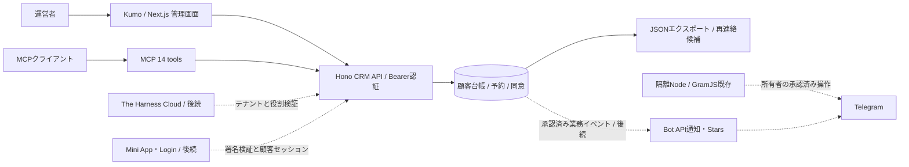
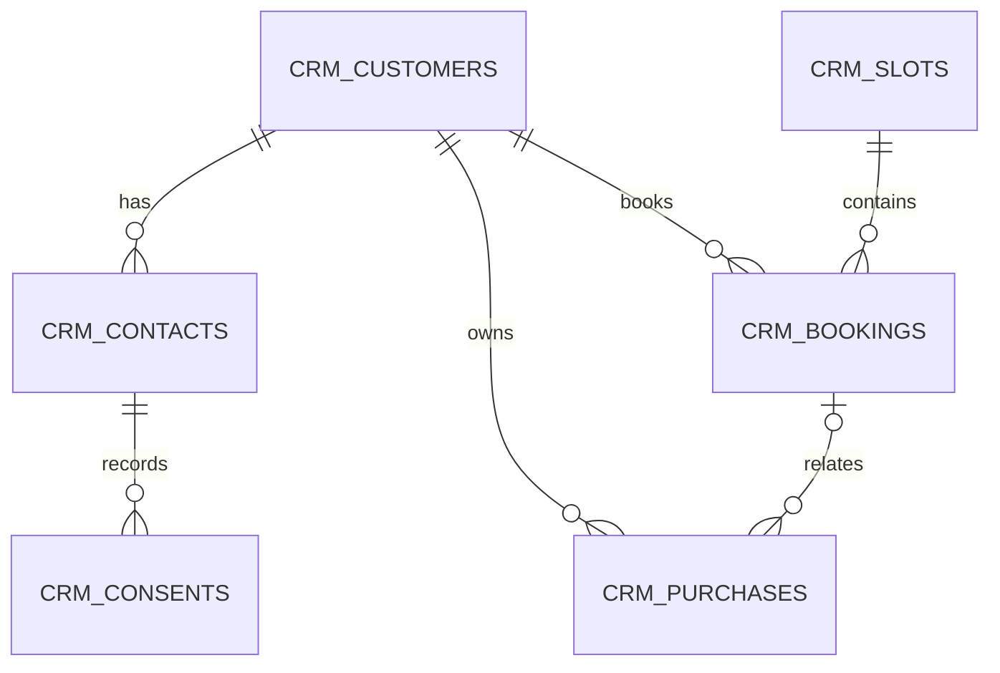
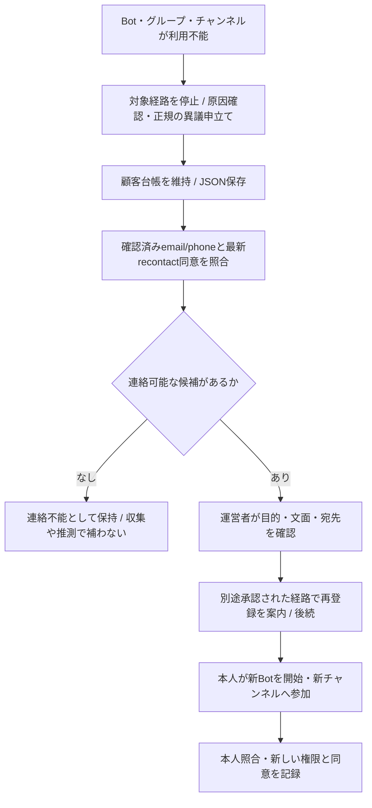
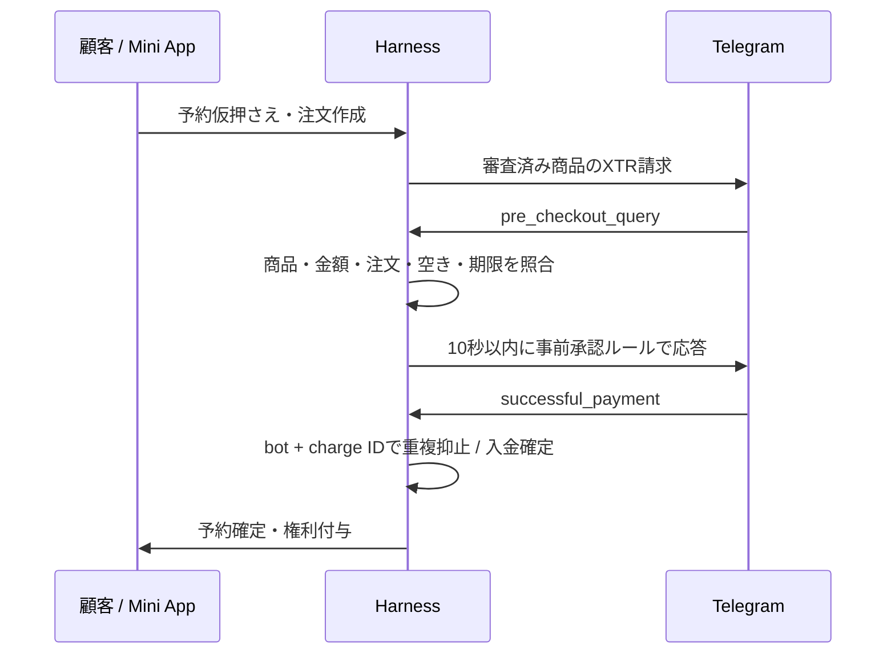

# Telegram Harness — 顧客管理・予約管理アーキテクチャ

2026-11-05フェーズ2の追加実装・API/MCP・通知整合性は [phase2.md](phase2.md)。以下のフェーズ1記録と将来設計は保持する。

フェーズ1は単一運営者・単一DBのローカル管理環境。LINE Harnessの「顧客を共通台帳で管理し、タグ・業務記録をつなぐ」思想を参考にする。Telegram Botやチャンネルを顧客の親レコードにせず、BANやBot切替によって顧客・同意・予約を削除しない。

## 全体構成

実装: `packages/db/src/crm.ts`、`apps/worker/src/routes/crm.ts`、`packages/mcp/src/crm-tools.ts`、`apps/web/src/app/crm/`。UI/SDK/MCPは同じAPIを利用する。Telegramへの送信はCRMルートから行わない。既存の投稿・本人アカウント機能は従来の承認経路を維持する。

## 顧客台帳

| テーブル | 主な項目・制約 |
|---|---|
| crm_customers | 独立UUID、表示名、流入元、タグ配列、作成・更新時刻。Bot外部キーなし |
| crm_contacts | 顧客ID、email/phone/telegram、正規化値、Telegramの場合Bot scope、確認証跡・確認日時。kind/value/scope一意。連絡先登録と確認は別操作 |
| crm_consents | 連絡先、recontact/booking/marketing、granted/revoked、証跡、ポリシー版、本人操作日時、記録日時、単調増加sequence。追記のみ |
| crm_slots | タイトル、開始・終了UTC、定員1〜1000 |
| crm_bookings | 顧客、枠、冪等キー、confirmed/cancelled、取消日時。稼働中の顧客×枠は一意 |
| crm_purchases | 顧客、任意の予約、Bot参照、charge ID、XTR整数金額、pending/paid/refunded/failed。フェーズ1は保存先スキーマのみ |

メールは小文字化、電話はE.164、Telegram IDは文字列で保存。連絡先の共有・名寄せは自動で行わず、重複は409で止める。検証済みというフラグは管理者が実際の確認証跡を記録する機能であり、本人確認メール／OTP送信は未実装。同意文面は用途・媒体・運営主体を特定し、証跡に保存先ID等を記録する。同意の過去日時への巻戻しを拒否し、最新記録が撤回なら抽出しない。ログイン・予約・チャット参加を同意に読み替えない。

SQLite/D1共通migration `0003_crm_core.sql`。Nodeはmigrationを未適用分だけ順にトランザクション実行。既存DBの顧客化は自動実行しない。D1適用は後続の承認対象。DBは個人情報を含むため秘密トークンがなくても公開しない。

## 予約の整合性

1. 管理者が将来の開始／終了と定員を指定。入力には時差を必須とし、UTCへ正規化。表示は日本時間。
2. 顧客と枠の存在・開始前を確認。クライアントは1回の操作に1つのrequestKeyを割り当てる。
3. SQL INSERTと同時にDB triggerで定員を検査。競合時は409。顧客×枠の部分一意indexで二重予約も拒否。
4. 同じキー・同じ顧客／枠の再試行は既存結果を返す。異なる内容のキー再利用は409。キャンセル済みキーの再送で予約を復活させない。
5. キャンセルは状態条件付きUPDATE。再キャンセルは同じ結果。空きはconfirmed行数から算出するため増減カウンタのずれを作らない。

枠編集・スタッフ／部屋の重複検査・繰返し枠・キャンセル期限・仮押さえ・通知は後続。フェーズ1の予約は管理者受付であり、顧客自身の公開予約APIではない。

## BAN時の再連絡

フェーズ1はC・Dまで。`/recontact` は確認済みemail/phoneに対する最新の`recontact=granted`のみ返す。Telegram ID、未確認、同意なし、marketingだけ、撤回済みは除外。メール／電話も送信しない。別Bot・別チャンネルでの再連絡は本人が正規に参加・許可することが条件で、BANや制限回避を目的としたBot自動切替は作らない。

`/export`は顧客ごとに連絡先・同意履歴・予約・購入を含むJSON。管理キー必須、Cache-Control:no-store、50件既定・最大100件。`nextCursor`がnullになるまで`after`に渡して保存する。秘密トークン・セッション・既存メッセージは含まない。ページ間の同時更新に対するスナップショット保証はないため、復旧用の完全バックアップは書込み停止中に取得するかDBバックアップを併用する。取得物は暗号化された非公開保管先へ、アクセス・保存期限を設定する。復元ツール、監査ログ、削除／訂正の運用はフェーズ2の必須タスク。

## Stars決済（設計のみ・導入審査前提）

商品をデジタル／物理・対面サービスに分類し、対象国・規約・返金責任・問い合わせ窓口を運営者が確認する。Starsはこの審査後のみ有効化。すべての商流への適用や換金を確約しない。

`invoiceClosed`やpre_checkout承認だけで購入確定しない。二重・順序逆転・期限切れ・払込後の枠喪失・返金の再試行を扱う。予約取消と返金は別状態で照合する。`/paysupport`等の購入問い合わせ、規約表示、返金運用を揃える。事前審査された固定ルールの即時応答は、既存の人による投稿承認とは別仕様として実装する。今回のコードでは決済APIは追加しない。[Stars仕様](https://core.telegram.org/bots/payments-stars)

## Kumo UI画面

| 画面 | フェーズ1 | 後続 |
|---|---|---|
| 顧客一覧 `/crm/customers` | 一覧、タグ、流入元、登録、ページ送り、空状態、接続エラー | 検索・詳細編集・連絡先確認・同意管理UI |
| 予約一覧 `/crm/bookings` | 枠作成、空き数、予約登録、取消、ページ送り | カレンダー、担当者、枠変更、顧客の自助操作 |
| 顧客詳細・同意 | API/MCPで利用 | 詳細画面、本人照合・訂正・削除 |
| 再連絡・書き出し | API/MCPで利用 | 非公開ダウンロード、承認・監査UI |
| 購入・返金 | スキーマのみ | 審査状態、注文照合、返金管理 |
| Cloud管理 | 未接続 | テナント・Bot・役割・監査・運用停止 |

`@cloudflare/kumo`のInput/Button/Badgeとstandalone CSSを利用。APIキーはNextサーバーだけに置く。開発／起動は127.0.0.1へbindし、`TELEGRAM_LOCAL_UI=true`の明示とlocalhost Hostを必須とする。これは単一ユーザーのローカル環境向け境界であり、Cloud認証やLAN公開の認可ではない。

## MCP / API対応一覧

全CRM機能は同じ管理キーで以下から操作可能。全GET一覧はafter/limit。IDはURLエンコードする。入力はAPI側で型・サイズ・用途・日時を検査する。

| MCPツール | API（/api/crm配下） |
|---|---|
| crm_list_customers | GET /customers |
| crm_create_customer | POST /customers |
| crm_get_customer | GET /customers/:id |
| crm_update_customer | POST /customers/:id/update |
| crm_add_contact | POST /customers/:id/contacts |
| crm_verify_contact | POST /contacts/:id/verify |
| crm_record_consent | POST /contacts/:id/consents |
| crm_list_slots | GET /slots |
| crm_create_slot | POST /slots |
| crm_list_bookings | GET /bookings |
| crm_book | POST /bookings |
| crm_cancel_booking | POST /bookings/:id/cancel |
| crm_export_customers | GET /export |
| crm_list_recontact | GET /recontact |

## The Harness Cloud（設計・未接続）

Cloud製品定義への登録、バージョン付きbundle、テナント開通、秘密注入、課金・停止・解約時の保存／削除を追加する。**テナントごとにWorker・D1を分離**し、Cloud署名セッションからテナントとoperator/read/export等の役割を確定する。API・Server Action・MCPの全経路で検証し、クライアント指定のtenant IDを信用しない。現フェーズの単一API_KEY構成をそのまま共有Cloudへ置かない。

Mini Appは検証済みTelegram IDを自社顧客へ紐付ける専用認証層を追加し、管理者Bearer経路とは分離する。Bot切替時の本人紐付けには確認済み連絡先等を使い、表示名・usernameだけで自動統合しない。GramJSは長時間接続・セッションの境界を持つ別サービスとし、共有Workersへ持ち込まない。D1移行前に復元・テナント越境・二重通知を検証し、配信担当を一つに固定する。

## 負荷と検証の限界

通常一覧は1クエリ／最大100行、枠一覧はindex付き予約数集計、再連絡はcontact/consentのindexで照合。エクスポートはページN件につき1+5Nクエリ（顧客・連絡先・同意・予約・購入）。各顧客の子履歴は全件含むので大規模利用前に子履歴のページング／ストリーミングとD1制約の実測が必要。公開本番の大量データ対応をフェーズ1完了とは呼ばない。

ローカルSQLiteをD1互換adapterでテストする。実Cloudflare D1へのmigration・実負荷・Telegram実操作・ブラウザ上の見た目はそれぞれ別の検証項目。バックアップはBotのBANからの独立性を持つが、運営者DB喪失からの復旧は別途バックアップが必要。
