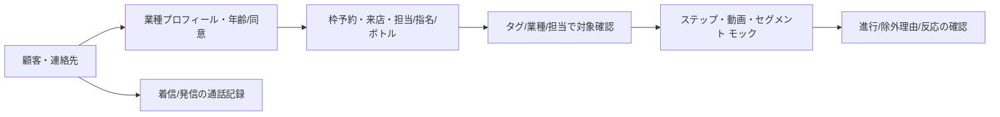

# 業種別顧客管理テンプレート

2026-11-05。Botが変わっても顧客台帳を保持する。以下の6テンプレートは `/crm/engagement?kind=profiles`、`engagement_profile`、`POST /api/crm/engagement/profiles`で入力できる。テンプレートの正本は `packages/shared/src/industry.ts`。仕様にない自由項目を無制限保存せず、業種ごとの許可フィールドを検証する。

## 共通台帳

| 項目 | 記録先・用途 | 完了状態 / 残り |
|---|---|---|
| 独立顧客ID、表示名、流入元、タグ | crm_customers | 保存・更新・ページング済。検索・重複統合は残り |
| Telegram/email/phone、Bot scope、確認証跡 | crm_contacts | 連絡先ごとに確認。名前だけの自動統合なし |
| marketing/booking/recontactの許可・撤回、文面版、日時、証跡 | crm_consents | 追記履歴。最新同意で配信を判断 |
| サービス情報の保存・利用同意、文面版、証跡 | profiles.serviceConsent/consentEvidence/policyVersion | 追記履歴。marketing許可へ変換しない |
| 年齢確認済/未確認、確認時年齢、確認の方法/担当、記録時刻 | profiles.ageStatus/ageYears/ageEvidence、createdAt | 証明書番号・画像を必須にしない。ナイト業種は未確認/18歳未満を登録拒否 |
| 来店日時、担当/キャスト、指名、施術/コース、ボトル番号・期限、金額/通貨、メモ、飲酒有無 | visits | 履歴追加・顧客別一覧済。サービス同意必須、飲酒時20歳以上を検査 |
| 予約日時、枠、定員、取消、通知 | 既存bookings/slots/notifications | 既存モック予約。担当ごとの空き時間・部屋/席競合は残り |
| 通話方向incoming/outgoing、日時、国際電話番号、顧客ID、メモ、入力元 | calls | 手入力/Webhook模擬入力。電話番号だけで別顧客を自動紐付けしない。録音・自動発信は不要 |
| 動画案内、反応、シナリオ進行 | videos/video-events/executions | モック配信。リンククリック/本人視聴申告を別々に記録 |

## 業種ごとの項目・必要機能

| 業種 | 業種専用プロフィール（APIフィールド） | 来店時に記録する内容 | 必要な運用機能と現在の範囲 |
|---|---|---|---|
| 美容室・美容サロン `beauty` | 希望担当 preferredStaff、施術 service、アレルギー allergyNote、好み preferences、次回予定 nextVisit | 担当、施術/コース、料金、必要な施術メモ | 予約→事前案内→来店→次回案内。台帳/タグ/配信モック済。施術時間・席・スタッフ競合、回数券残高は残り |
| 飲食店 `restaurant` | 希望担当 preferredStaff、アレルギー allergyNote、席希望 seatPreference、コース course、人数 partySize | 担当、コース、会計、来店メモ | 席/人数予約、キャンセル連絡、再来店施策。枠予約/台帳/配信モック済。テーブル割当・食材在庫・POS照合は残り |
| 整体・リラクゼーション `wellness` | 希望担当 preferredStaff、施術 service、施術メモ careNote、禁忌/配慮 contraindications、次回予定 nextVisit | 担当、施術/コース、料金、必要な経過メモ | 定期予約、事前同意、次回案内。台帳/配信モック済。医療診断には使わず、敏感な情報の項目別権限・保持期間は公開前に実装 |
| キャバクラ `cabaret` | 希望キャスト preferredStaff、指名区分 nomination、席希望 seatPreference、コース course、ボトル bottle、好み preferences | 担当/キャスト、指名、コース、ボトル/保管期限、会計、飲酒有無 | 年齢確認/同意履歴/来店/配信モック済。キャスト別アクセス、席/シフト、指名実績集計、ボトル在庫は残り |
| ホストクラブ `host` | 希望ホスト preferredStaff、指名区分 nomination、コース course、ボトル bottle、好み preferences | 担当ホスト、指名、コース、ボトル、会計、飲酒有無 | 年齢確認/同意履歴/来店/配信モック済。担当別権限と売上/指名集計は残り。債権回収や過度な消費誘導を自動化する設計ではない |
| バー `bar` | 希望担当 preferredStaff、席希望 seatPreference、ボトル bottle、ボトル期限 bottleExpiresAt、好み preferences | 担当、飲酒有無、会計、ボトル番号/保管期限 | 年齢確認/同意履歴/来店/配信モック済。キープ期限の自動通知・ボトル残量/在庫・POSは残り |

プロフィール文字列は1項目1,000文字まで。年齢は整数、来店金額は最小通貨単位の非負整数（JPYは円、USD/EURはセント）。人数や次回来店予定などのプロフィール項目は現時点では案内用文字列で、予約在庫や日時制約としては評価しない。予約は既存slots/bookingsの正規日時・定員で管理する。

## ナイト業種の必須条件

1. 年齢確認とその証跡、サービス情報利用の許可/撤回と文面版を必ず記録。サービス同意を撤回しても履歴は残し、来店新規記録とナイト業種のmarketingモックを止める。連絡先のmarketing同意は別に必要。
2. 今回は商品側の最低入力条件として、ナイト業種プロフィールを18歳以上、飲酒記録を20歳以上に制限する。これは店舗の営業許可、地域、営業時間、入店条件など全法令を満たす判定器ではない。法令・地域の営業条件は提供前に運営者が確認し、必要なら条件をより厳しく設定する。
3. 証跡に必要以上の身分証番号や画像を入れない。本人の訂正/削除手順、スタッフ別可視範囲、保持期限、アクセス監査は公開前の必須残件。
4. サービス同意と販促同意を混同しない。未確認連絡先・別Bot・marketing撤回済み・停止済み実行には配信しない。電話記録はスタッフの受付履歴であり、記録した番号への営業連絡許可を作らない。

## 入力から運用まで

プロフィールは変更のたび新しい記録IDで追記。通信再試行は同じ記録IDと同じ内容で再送する。来店・通話も同じIDの異なる内容は409にする。プロフィールの現在値はDB挿入順の最新履歴で、同一時刻の追記や古いリクエストの再送でも最新同意を巻き戻さない。手入力の誤りの訂正UI/履歴関連付けは残件に含む。
