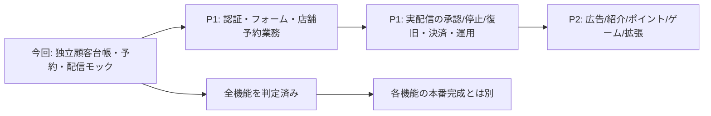

# L Harness → Telegram Harness 機能同等性

確認日: 2026-11-05。比較元 `/Users/ai/claudecode/line-harness`、ローカルHEAD `3db88014af76718f02e810bfffeb0d30985657bd`。未コミットの変更と非ignoreの新規ソースを含む作業ツリーを比較対象とし、各ファイルの状態・ハッシュを保存した。HEADの内容だけを読んだという意味ではない。本番やCloudの配布版と同一とは断定しない。

目標は**業務としてできることの同等性**。LINE固有UIの形をそのまま再現する意味ではない。今回のフェーズ3はP0のモック実装までであり、全機能同等・販売開始可能・本番配信可能とは表示しない。

## 抽出方法と読み方

READMEだけに依存せず、全worker route/service、MCP登録元、wiki/manual/plugin資料など248ファイル・405のHTTP入口をローカルで照合した。操作単位の元ファイル・行番号は [補助索引](parity-lharness-index.md)、ハッシュ・HTTP入口・見出しは [抽出データ](parity-lharness-inventory.json)。`python3 scripts/inventory-lharness.py /path/to/line-harness` で再抽出でき、未分類のroute/service追加時は失敗する。コード本文は複製していない。`COMPETITOR_FEATURES.md`とSPECの構想は実装済み機能の証拠に数えない。

判定: **可**=Telegram/自前CRMで実現可能、**代替**=LINE固有の体験・データを別方式に置換、**不可**=同じ観測や動作はできない、**除外**=依頼で禁止。優先度P0=今回の中核、P1=売れる店舗運用に必要、P2=拡張、対象外=禁止。状態の「未」は未実装、「部分」は一部のみ、「モック」は外部送信ゼロ。可否と現在の実装状態は別列。

## 全機能の判定表

| ID | L Harnessで確認した機能・下位機能 | 元の根拠（routes/はapps/worker/src/routes） | Telegramでの実現方法・代替案 | 判定 | 優先 | 今回終了時点 |
|---|---|---|---|---|---|---|
| F01 | 友だち自動登録、一覧・検索・詳細・編集、メタデータ、プロフィール更新、UUID人物統合、重複検知・プレビュー、インポート、グループ化 | routes/friends, users, users-grouped, duplicates, profile-refresh; services/follower-import | 独立顧客ID＋Bot別Telegram contact。本人開始・確認済み連絡先で紐付け。LINE人物IDは移植不可 | 代替 | P0/P1 | 台帳・タグ・同意・ページング・export、業種プロフィール済。検索・統合・import未 |
| F02 | タグCRUD、付与・解除、タグ変更イベント、タグ連動処理 | routes/tags; services/friend-tag-attach | 顧客tags、セグメント条件と分岐。タグマスターとイベントバスを追加 | 可 | P0/P1 | tags更新・判定済、マスター/自動トリガー未 |
| F03 | シナリオCRUD、手動/友だち追加/タグ開始、ステップ遅延、タグ有無・metadata一致/不一致分岐、次ステップ、停止/再開、統計 | routes/scenarios; services/step-delivery, immediate-first-step, scenario-stats; wiki/Scenarios | DB実行状態＋Bot APIジョブ。日付・遅延・条件は自前実装 | 可 | P0 | 不変シナリオ作成、手動登録、相対遅延、tag/source/industry/staff eq/neq、前向き分岐、停止、履歴をモック実装。編集・再開・自動トリガー未 |
| F04 | 一斉/タグ/セグメント配信、AND/OR、配信予約、下書き/停止、履歴・件数、複数アカウント重複除外、再試行キー・送信エラー管理 | routes/broadcasts, dedup-preview; services/broadcast*, segment*, dedup-broadcast; wiki/Broadcasts | Bot scope固定、許可先だけ計画、送信前同意再照合、Telegramの正式上限を守るジョブ | 可 | P0/P1 | AND 4条件、ページ別preview/除外理由、固定宛先計画、遅延・停止・冪等モック。OR/横断重複/ライブ復旧未 |
| F05 | キーワード完全/部分一致、自動応答、アクション、ウェルカム応答 | routes/auto-replies; services/auto-reply, keyword-match, intro-message | Bot Update＋返信ルール | 可 | P1 | /book予約応答のみ。汎用ルール未 |
| F06 | テキスト・画像・動画・Flex等、メッセージ/施策テンプレ、変数、プレビュー・テスト配信 | routes/message-templates, templates; services/render-message | sendMessage/Photo/Video/MediaGroup、inline buttons、Mini App。Flex JSON互換は不可 | 代替 | P0/P1 | 既存投稿下書き/承認・写真/動画/アルバム、今回動画URL定義。汎用差込・施策テンプレ未 |
| F07 | リッチメニュー作成・画像・エリア、個人別切替、グループ/タブ/alias、公開 | routes/rich-menus, rich-menu-groups; wiki/09-Rich-Menus | コマンド、inline/reply keyboard、menu button、Mini Appホーム。画面下部LINE画像メニューそのものはない | 代替 | P1 | 予約inline buttonのみ。ホーム/個人別切替未 |
| F08 | フォーム作成・回答・メタデータ連動、LIFF認証、公開表示、本人ページ | routes/forms, liff; wiki/11-Forms-and-LIFF | Mini App＋initData検証＋回答台帳。管理フォームと顧客本人フォームを分離 | 代替 | P1 | 管理Kumoフォームのみ。顧客用フォーム/公開認証未 |
| F09 | 追跡リンク作成、クリック履歴、本人識別、URL自動追跡、OG/リダイレクト | routes/tracked-links; services/auto-track; index.ts | 署名短縮URL＋同意済み本人セッション。単なるクリックを視聴にしない | 代替 | P1 | 動画クリックのスタッフ模擬証跡のみ。公開redirect/計測未 |
| F10 | 流入経路、QR、広告/媒体ラベル、経路別タグ/シナリオ、traffic pool分配、紹介リンク | routes/entry-routes, traffic-pools; index.ts /r,/o,/api/qr | t.me deep link start parameter＋流入履歴。Bot開始前の人物推定はしない | 代替 | P1 | source文字列のみ。履歴・QR・分配未 |
| F11 | カレンダー、予約メニュー、担当スタッフ、週次/例外受付時間、所要時間/余白、空き枠、仮押さえTTL、受付/確定/取消、Google busy除外・同期・OAuth | routes/calendar, booking; services/booking*, availability, google-* | 自前予約DB＋inline calendar/Mini App＋Google API adapter | 可 | P0/P1 | 枠・定員・冪等予約・取消、group/topic受付、モック通知済。担当の稼働/重複/外部連携未 |
| F12 | イベント、複数日程、定員、申込、履歴、取消、仮押さえ、通知 | routes/events; services/event-* | イベントと枠・顧客台帳、Mini App申込 | 可 | P1 | 共通予約枠のみ。イベント固有設定/公開画面未 |
| F13 | ウェビナーCTAから即時相談予約、Google Meet発行、外部event ID紐付け、前日/1時間前通知、取消同期 | routes/meet-consultations, meet-callback; services/webinar-consultation-booking; wiki/28-* | Mini App CTA＋Google Calendar/Meet adapter | 可 | P1 | 未。現在の予約通知は確認・24時間前のみ |
| F14 | 日付/予約ベースのリマインド、停止・配信ログ | routes/reminders; services/reminder-delivery | 期限付き永続ジョブ＋同意・取消再確認 | 可 | P0/P1 | 予約通知モック済。汎用ルール・cron未 |
| F15 | 動画登録/差替、HLS保護配信、疑似ライブ、視聴予約・開始時刻、再生位置、CTA/コメント、フォーム導線、離脱・日次・参加者・ファネル分析、追客 | routes/webinars; services/webinar-*; MCP/manage-webinar-video | ネイティブsendVideoまたはリンク。詳細進捗は認証付き自前プレイヤー/Mini Appで本人許可のイベント計測 | 代替 | P0/P1 | 動画/リンクの配信モック、クリック/本人視聴申告の模擬証跡。HLS・プレイヤー・疑似ライブ/統計は未 |
| F16 | Stripe顧客・商品/購入、決済イベント・CV、注文連携 | routes/stripe; packages/db/src/stripe | Telegram内デジタル商品はStars、物販/店舗サービスは適用規約を確認したprovider。LINE/Stripe連携を無条件に転用しない | 代替 | P1 | 購入テーブル土台のみ。請求・入金確定・返金未 |
| F17 | スコア定義、イベント加点、閾値、履歴 | routes/scoring; wiki/13-Scoring | 自前ルール＋顧客イベント | 可 | P2 | 未 |
| F18 | IF-THEN、優先度、タグ/メタデータ/シナリオ/メニュー/メッセージ/Webhookのアクション、ログ | routes/automations; services/event-bus; wiki/14-Automation | BotイベントとCRMイベントを正規化、承認付きaction adapter | 可 | P1 | シナリオの限定条件のみ。汎用engine未 |
| F19 | LINE署名Webhook、外部受信/送信Webhook、ログ、再試行 | routes/webhook, webhooks; services/webhook-signature | Telegram secret_token＋重複Update対策、各provider署名、外部送信承認 | 代替 | P1 | 既存Bot入口土台、今回通話は管理認証付きモック入口のみ。公開provider接続未 |
| F20 | 担当者通知、アクション通知、メール/外部通知、活動ダイジェスト | routes/notifications; services/activity-digest | Telegram管理者通知/メールadapter＋明示同意・権限 | 可 | P1 | 予約モック通知以外未 |
| F21 | 1対1チャット、会話一覧/詳細、返信、担当、未返信inbox、他経路会話 | routes/chats, conversations, inbox; services/unanswered-inbox | Bot/private会話受信・返信、スタッフ受信箱。ユーザーアカウント層は別権限 | 代替 | P1 | 既存更新/owner-account土台のみ。スタッフ会話UI未 |
| F22 | 画像アップロード/受信、非公開保存、検証・アクセス認可 | routes/images; services/incoming-image | Telegram file経路→非公開ストレージ＋期限付き認可URL | 可 | P1 | 投稿URL指定のみ。安全なupload・受信画像保管未 |
| F23 | CV地点/発火、コンバージョン履歴、帰属、承認/却下 | routes/conversions; wiki/17-* | 注文・来店・予約イベントとCV台帳 | 可 | P2 | 来店記録はできるがCV定義/集計未 |
| F24 | 広告プラットフォーム設定、広告コンバージョン、insight取得 | routes/ad-platforms; services/ad-conversion, insight-fetcher | 各広告API adapter、許可された識別子だけ送信 | 可 | P2 | 未 |
| F25 | 紹介者/ASP、セルフ登録、媒体別リンク、案件/オファー、参加、last-touch帰属、自己クリック除外、重複フラグ、成果承認、報酬・レポート | routes/affiliates, affiliate-self, affiliate-offers; wiki/27-* | Mini App認証＋紹介台帳。成果/報酬は監査・承認付き | 可 | P2 | 未 |
| F26 | ライブゲーム/6ゲーム、ルーム、host操作、リアルタイム状態、チェックアウト、leaderboard、コミュニティ | routes/live-games, six-games; services/live-game*, six-* | Mini App/HTML5＋サーバー部屋状態。店舗用途と提供条件を確認 | 代替 | P2 | 未 |
| F27 | マルチLINEアカウント、設定、認証更新、ヘルス/BAN検知、利用可能経路の停止/移行 | routes/line-accounts, account-settings; services/ban-monitor, token-refresh | 複数Bot scope、権限喪失を停止。新BotへDM許可を自動移植しない | 代替 | P1 | Bot登録・今回scope分離済。運用ダッシュボード/移行未 |
| F28 | owner/admin/staff、限定キー、セッション/失効、SSO、署名・公開画面認可 | routes/staff, admin-auth, admin-sso; middleware | テナント/役割別認可、Mini App initData、秘密の隔離 | 可 | P1 | ローカル管理キー・UI loopback限定のみ。公開認証/RBAC未 |
| F29 | バージョン/更新確認、手動更新、設定保持、署名更新エンジン・切戻し | routes/admin-update, admin-version; packages/update-engine; wiki/26-* | Telegram製品の署名配布・DB migration・設定保持 | 可 | P1 | ローカルmigrationのみ。配布/署名更新未 |
| F30 | 管理ダッシュボード、capabilities/OpenAPI/health、利用量/クォータ/通知、ログ保持、セットアップ、Cron/DOスケジューラ、費用測定 | routes/usage, capabilities, health, setup, openapi; scheduled.ts; durable-objects/tenant-scheduler.ts | Kumo＋検証環境、監視/期限ジョブ、実測上限・DB課金評価 | 可 | P1 | ローカルUI/API health、期限分手動処理済。自動cron・運用監視・負荷測定未 |
| F31 | LINE API proxy、送信経路統一・tenant routing | routes/line-proxy; services/line-proxy-send | Telegram専用provider境界。LINE proxyのURLはTelegram用に流用しない | 代替 | P1 | Telegram clientとモック境界済。Cloudルーティング未 |
| F32 | Instagramエンゲージメント連携・交換情報 | routes/instagram-engagement | 別媒体adapter・本人同意・越境認可 | 可 | P2 | 未 |
| F33 | メディア問い合わせ受付・記録 | routes/media-inquiries | 管理台帳＋フォーム/受信イベント | 可 | P2 | 未 |
| F34 | MCPツール/Resources、SDK、AIによる配信/顧客/予約操作、API呼出し | packages/mcp-server/src/tools, resources; packages/sdk; wiki/24-* | Telegram MCP/SDK。UIと同じAPI・認可を使う | 可 | P0/P1 | 既存＋今回16ツール、対象APIへ接続済。未実装領域のツールは未 |
| F35 | マイレージ、活動/視聴ポイント、特典/報酬、キャンプoffer、再処理・帰属 | services/activity-mileage, webinar-mileage, reward-*, camp-offer-delivery; docs/community-mile-rewards | 自前ポイント台帳＋根拠イベント。クリックを視聴報酬に直結しない | 可 | P2 | 未 |
| F36 | プラグイン登録・catalog、拡張API、タグルールplugin・開発テンプレ | docs/plugins; examples/plugins/tag-rules; packages/plugin-template; web/lib/plugin-catalog | 安全な拡張境界・権限・互換バージョン・ライセンス監査 | 可 | P2 | 未 |
| F37 | 自前設置、Cloud設定/配布、D1/SQLite、バックアップ・移行・認可されたexport | README; wiki/21-Deployment, 22-Operations; packages/db | ローカルからテナント別環境へ。鍵/データ/同意履歴を保持 | 可 | P1 | ローカル永続化、migration/再起動/JSON読出し済。復元/Cloud未 |
| T01 | 店舗業務補強: 担当・指名・来店・ボトル/コース・年齢/同意 | Telegram追加要件。LINEの完成機能とは偽らない | 独立顧客IDへの業種プロフィールと来店イベント | 可 | P0 | 6業種テンプレ、履歴、基本入力制約、MCP/Kumo済。担当マスター/在庫/売上集計未 |
| T02 | 電話incoming/outgoing台帳、SMS provider差替 | Telegram追加要件＋既存phase2通信設計 | 通話日時/番号/顧客/メモを手入力または正規化Webhook。SMSはadapter境界 | 可 | P0 | 手入力/管理認証Webhookモック、MCP/Kumo、SMS mock interface済。発信機能不要 |
| N01 | Telegramネイティブ動画の個人別再生率/視聴完了・既読 | Bot API Update/Messageで対象イベントを公開していない | クリック・本人申告は別イベント。詳細視聴は同意付き自前プレイヤーを別実装 | 不可（そのまま） | P0 | native_playback_unavailableを明示、虚偽の完了率なし |
| X01 | ステルス配信、ジッター/文面変異による検知回避、BAN後の自動迂回 | README; services/stealth; wiki/18-* | 移植しない。正規のレート制御・権限停止・許可された本人再登録は別要件 | 除外 | 対象外 | 未実装、今後も同等化対象に数えない |

## Telegram側の一次資料

- [Bot API: sendVideo](https://core.telegram.org/bots/api#sendvideo)、[Update](https://core.telegram.org/bots/api#update): 動画送信と受信イベント仕様。動画送信結果と視聴完了は別で、ここから個人別再生率は導けない。
- [Mini Apps](https://core.telegram.org/bots/webapps): inline/menuボタン起動とinitData検証。リッチメニューやLIFFはこの体験へ置換する。
- [Stars決済](https://core.telegram.org/bots/payments-stars): Telegram内デジタル商品/サービスの決済条件。決済導入は商品区分・提供者の審査と返金設計を含めて別途完成させる。
- [Bot Features](https://core.telegram.org/bots/features): コマンド、deep link、メニューなどの実現手段。

## 同等化の順序

残項目の完了条件は [DOD.md](DOD.md)。実Telegram表示/公開認証/運用監視と販売時の責任分担が揃うまで、本番運用可能な「L Harness同等製品」とは扱わない。
