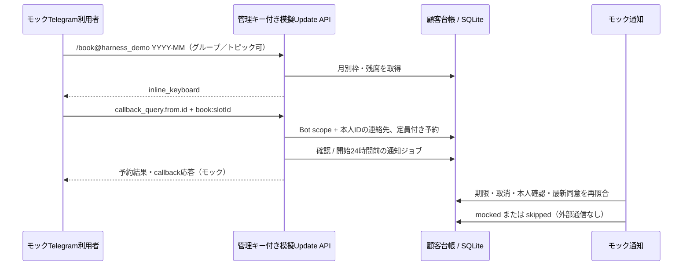

# Telegram Harness — フェーズ2（2026-11-05依頼の範囲）

本フェーズはローカルの**インラインボタン式予約＋モック通知**。従来DODの認証・Mini App・復元・公開運用をまとめて完了とするものではない。

## 起動と画面

READMEのローカル起動手順を使用。`node-server.ts`は両方のnetwork設定がtrueなら起動を拒否し、モック入口を明示有効化する。画面は `http://127.0.0.1:3005/crm/booking-bot`。Nextの `TELEGRAM_LOCAL_UI=true`、loopback Host制限、サーバー側管理キーを維持。

1. 顧客台帳・予約管理から必要な電話顧客と将来枠を作成する（Telegram合成顧客はcallback受付時に作成）。
2. カレンダーの月はUTCのYYYY-MM。日時はUTC表記（日本時間は+9時間）。先頭100枠まで。満席と開始済みは予約ボタンから除外。
3. 模擬TelegramのBot名・本人ID・チャット種類・chat IDを指定。`/book`または`/book@Bot名 YYYY-MM`を実行する。グループは負数chat ID、トピックは正数thread ID。
4. 同じフォームでインラインボタンを選ぶと予約が台帳に入る。再送時は同じupdate IDを使用。別人・別枠への同じキー流用は409。同一人物の同一枠の重複と定員超過も拒否。
5. 通知一覧で期限到来分をモック処理。確認は予約時、リマインダーは24時間前。自動タイマーは接続せず、UI/MCP/APIから明示実行する。1回最大100件で残りは再実行する。
6. 電話はphone連絡先ID・枠IDで手入力受付。本人確認・booking同意を別フォームで記録する。

Telegramの予約確認は操作への応答として扱い、marketing同意を作らない。リマインダーは別のbooking同意が必要。SMS/voiceは確認・リマインダー両方に本人確認と同意が必要。通知は元チャット／トピックへ返し、グループの通知本文には名前・電話・顧客IDを含めない。実送信時のDM許可移植や全員へのメンションは実装しない。

## API・MCP・画面の対応

すべて管理APIキー必須。INTAKE_API_KEYは不可。`/api/crm/booking-bot`配下、`Cache-Control:no-store`、JSON本文64KiB上限。`TELEGRAM_BOOKING_MOCK=true`かつdry-run client以外は503。公開Telegram webhook・顧客用APIではない。

| API | MCPツール | Kumo画面 |
|---|---|---|
| GET /calendar?month=YYYY-MM | booking_calendar | 月選択・枠カード・inline_keyboard表示 |
| POST /update {botId,update} | booking_mock_update | コマンド／callback、1対1／group／supergroup／topicの模擬受付 |
| POST /phone {contactId,slotId,requestKey,channel} | booking_phone_intake | スタッフの電話予約（SMS/voice選択） |
| GET /notifications?after=&limit= | booking_list_notifications | 状態・期限・理由・ページ送り |
| POST /notifications/run | booking_run_notifications | 予約確認・リマインダーのモック処理 |
| 既存 /customers、/contacts/:id/verify、/contacts/:id/consents | 既存crmツール | 連絡先表示・phone追加・確認・許可／撤回 |

MCPサーバー表示名は `Telegram Harness`。パッケージ名・ディレクトリ・環境変数は機械識別子として従来の `telegram-harness` を維持する。

## データ整合性と停止条件

新規の合成Telegram顧客は再試行に耐える固定ID `tg:<bot scope>:<user ID>`を使う。既存の同じTelegram連絡先があれば、その独立した顧客IDへ紐付ける。Botテーブルへの外部キーやBot削除への連動はなく、台帳を保持する。これはモック用識別方式で、公開顧客ID・本人認証の方式ではない。

migration `0004_booking_delivery.sql`。`crm_booking_routes`は予約ごとに通知媒体・宛先・トピック・contactとsourceを保持。`crm_notifications`は予約×confirmation/reminderの一意制約。予約作成と通知準備は複数のSQL文なので、途中失敗時は**同じキー**で再実行して通知準備を完了する。部分作成された予約を新しいキーで上書きしない。phoneの連絡先・媒体・宛先を同じキーで変えた場合はroute conflict。

通知ジョブの状態は `pending → mocked/skipped`。最新同意、開始前、確認済み、取消状態を照合し、条件付きUPDATEで複数実行者による二重処理を防ぐ。`skipped`を同意追加だけで復活させず、後から過去通知を送らない。予約取消は台帳を保持し、保留通知が次の処理でskippedになる。

モックは通信を持たないため処理前に状態を確定する。将来のライブ送信にはunknown状態・lease・配信照合・Webhook署名・再試行上限が必要。現在のSQL条件付きUPDATEを外部送信のexactly-once保証とは呼ばない。

## 検証範囲

- `pnpm test`: 既存回帰＋実SQLite、実localhost HTTP、全5追加MCPツール、topic保持、定員競合、キー再送、同意撤回、取消、本人ID偽装の無視、匿名/Bot/channel拒否、phone/SMS/voiceモック、再起動。
- `pnpm typecheck`、`pnpm --filter web build`。
- `node scripts/phase2-http-smoke.mjs`: 一時DBとloopbackサーバーを起動。SSR HTML・CSS、NextフォームのServer Actionでgroup予約と電話受付、台帳と通知を照合。最後に自身のサーバーと一時DBを片付ける。ブラウザを起動しない。
- 実Telegram・SMS・電話の送信、Mini App/initData、ライブWebhook、実機の見た目、Cloud/D1本番適用は未検証・未実行。
