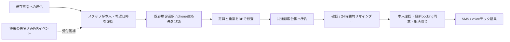

# Telegram Harness — SMS・電話連携の設計とモック基盤

確認日: 2026-11-05。今回の採用は**スタッフ手入力＋モック**。プロバイダ登録、番号購入、SMS送信、電話発信は行わない。日本の音声番号取得と日本向けSMS送信は別の能力であり、一方の契約で他方が使えると扱わない。

## 候補比較（一次資料で確認した範囲）

| 候補 | 日本の音声番号・通話 | 日本向けSMS | 料金（USD、公開表示の抜粋） | 条件・未確認事項／出典 |
|---|---|---|---|---|
| Twilio | National／Local 0ABJ／Toll-freeの提供区分あり。番号種別・法人資料等の審査がある | 国際／国内gatewayが別。国内は登録・営業相談が必要。固定電話宛SMS不可 | SMS long code送信 $0.0890/segment、英数字ID $0.089/segment。音声国内固定等 $0.0746/分、携帯 $0.1850/分。番号月額National $4.75、Local 0ABJ $20、Toll-free $25 | [SMS料金](https://www.twilio.com/en-us/sms/pricing/jp)（2026-10表示）、[Voice料金](https://www.twilio.com/en-us/voice/pricing/jp)（2026-08表示）、[SMS条件](https://www.twilio.com/en-us/guidelines/jp/sms)、[番号審査](https://www.twilio.com/en-us/guidelines/jp/regulatory)。税・追加料金・複数segment・録音/TTS等は別。ページ内の受信欄にあるLocal月額と番号種別表の分類差は要確認。実契約の見積りではない |
| Vonage | Japanのlandline音声番号はリクエスト制、購入要件も問い合わせ | 日本向けの英数字Sender ID対応。数値IDは2-wayサービス例外を除き非対応・上書きされると説明 | 日本の確定単価は今回取得できず不明。ダッシュボード／価格API・個別見積りで確認する | [音声番号一覧](https://api.support.vonage.com/hc/en-us/articles/115011761808-Voice-Numbers-Features-Overview)、[日本SMS制約](https://api.support.vonage.com/hc/en-us/articles/204017353-Japan-SMS-Features-and-Restrictions)、[価格確認方法](https://developer.vonage.com/en/dashboard/control/pricing)。日本番号での双方向SMSは未確認で、音声番号から推測しない |
| 既存の電話回線＋手入力 | 顧客が既存番号へ電話しスタッフが受付 | 今回はモックのみ。将来は上記providerを別途選定 | 既存契約・受付工数は未確認のため金額を置かない | 番号移行を伴わず台帳統合を先に検証可能。通信APIの費用比較とは分ける |

資料が食い違う場合は最新の公式原文・番号種別・契約国を照合する。Twilioの古い日本語SMS記事と現行英語gateway説明は同じ提供状態とは限らない。提示料金を契約額・納期・番号在庫の保証にしない。

## 受付フロー

スタッフ画面は `/crm/booking-bot`。顧客登録・枠作成は既存の `/crm/customers` と `/crm/bookings`。顧客IDで連絡先を表示し、E.164のphoneを登録して得たcontactIdで受付する。phoneの重複は既存台帳の一意制約で止まり、名前・番号だけで自動統合しない。電話予約そのものは未確認連絡先でも保存できるが、SMS/voice通知は確認証跡と`booking=granted`が必要。

本人確認の記録は実際に確認したスタッフが行う。電話の着信番号表示だけを確認済み証跡としない。予約通知の同意はmarketing/recontactと別用途。撤回は追記し、通知実行時の最新記録で判断する。

## プロバイダ境界

`apps/worker/src/services/communications.ts` の `CommunicationsProvider.deliver()` は宛先、媒体、本文、threadId、idempotencyKeyを受ける。今回実装は `MockCommunications` のみ。Bot API/電話事業者SDKの呼出し、HTTP通信、秘密値、課金はない。`sms`と`voice`のモックは同一契約で差し替えテスト可能。ライブproviderは未実装で、`mode: mock`の型制約を含め本番導入時に明示的な設計変更を要する。

DBは `crm_booking_routes` で予約・連絡先・媒体・宛先・受付経路を紐付け、`crm_notifications` に確認／リマインダーを保存する。予約×通知種別は一意、処理の取得は条件付きUPDATE。再起動後も状態を保持する。`pending → mocked/skipped`はモック専用。ネットワーク失敗がないため事前確定する方式であり、ライブ送信へそのまま転用しない。

本番候補では `pending → processing → delivered/failed/unknown`、期限付きclaim、provider側冪等性、署名付きdelivery callback、照合APIを設計する。タイムアウトを「失敗」と断定して再発信せず`unknown`で停止・確認する。停止スイッチ、時間帯、同意撤回、費用上限、最大試行数、監査、担当者引継ぎを整えてからライブproviderを追加する。

## 将来の音声／IVR

1. 事業者Webhookの署名・timestamp・nonceを検証し、Call ID＋イベントIDで重複抑止。
2. 冒頭で用途・録音有無を案内し、録音／文字起こしの保持期間と閲覧者を定義する。今回録音はない。
3. DTMFまたは音声で希望枠を受け取り、本人照合を別処理にする。音声認識結果は予約候補とし、読み返しと確定操作を必要にする。
4. 人の確認後、今回の共通予約サービスと定員制御へ渡す。曖昧な日時・同名・認識失敗はスタッフへ引き継ぐ。
5. 接続切れ・空き枠競合・重複イベント・発信結果不明をモックで先に試験する。

## 運用案の見取り図（未契約・非公開の検討用）

| 案 | 全体像／具体的な仕事 | 楽観／通常／悲観 | 心の負担・割込み・責任範囲 | 成立条件／判断変更条件 |
|---|---|---|---|---|
| A: 手入力＋モック（今回） | 台帳を先に統一／スタッフが既存電話を受けて枠を選ぶ | 入力が定着／電話ごと入力／繁忙時に入力漏れ | 通話の割込みは残る。スタッフが本人照合と受付に責任 | 受付量が手入力で扱える。実測で入力漏れが増えるならBを再評価 |
| B: Twilio等で通知を追加 | 受付は人、通知だけAPI／番号・同意・到達状態を管理 | 通知が安定／例外対応あり／不達・結果不明 | 送信障害と料金監視の担当が必要 | 日本向け提供条件・契約・運用責任者を確認できること。見積り・双方向要件次第でVonage等も比較 |
| C: 音声／IVR受付 | 電話の入口も自動化／誤認識と引継ぎを管理 | 定型予約を処理／曖昧な相談は人／誤受付・切断対応 | 初期の設計と例外監視が増える。自動化しても顧客対応責任は残る | A/Bの実測から定型率と例外を確認し、本人照合・有人引継ぎが成立すること |

今回Aを選ぶ理由は、通信契約・実送信を行わず台帳と予約整合性を検証する依頼範囲に合うため。工数・費用削減率は未測定で推定値を置かない。

## 検証

`apps/worker/src/booking-bot.test.ts` は電話受付の再試行、既存顧客との紐付け、未確認時の通知停止、同意後のSMS/voiceモック、global fetch未呼出し、DB再起動保持を検証。ライブの到達率・番号審査・料金・音声品質を検証したという意味ではない。
